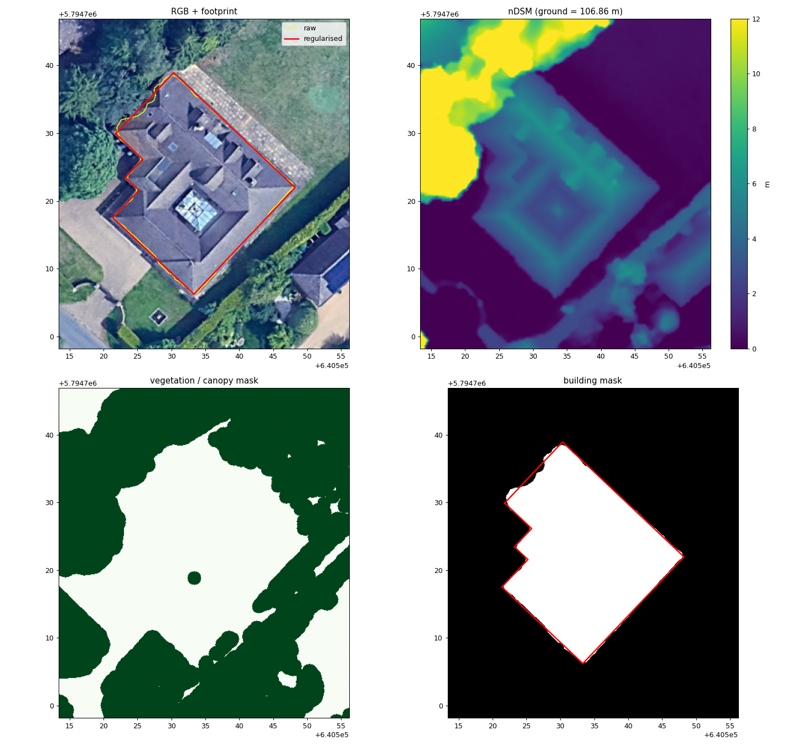
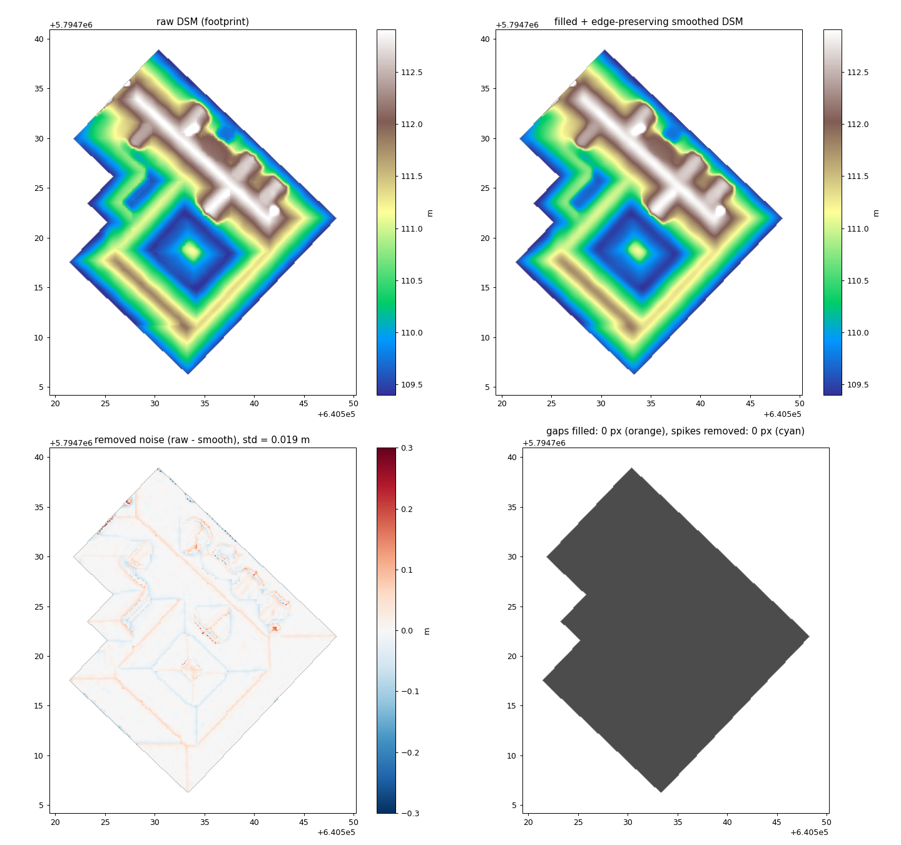
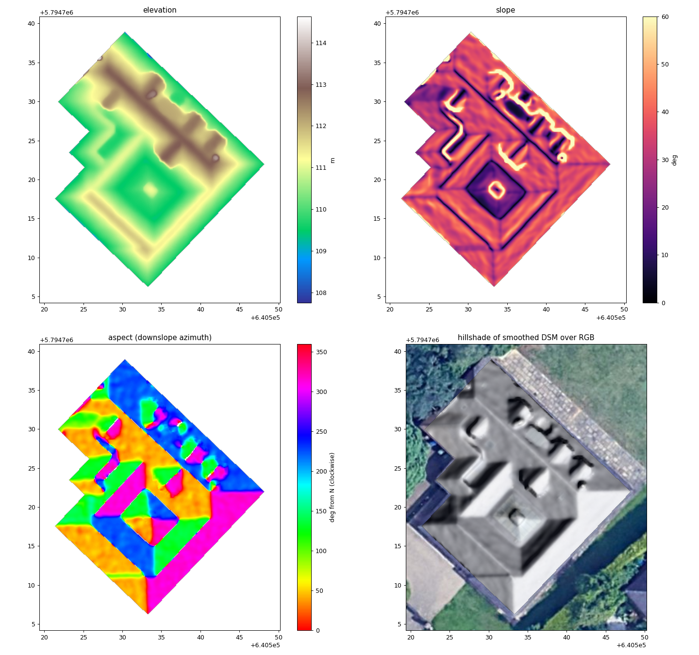
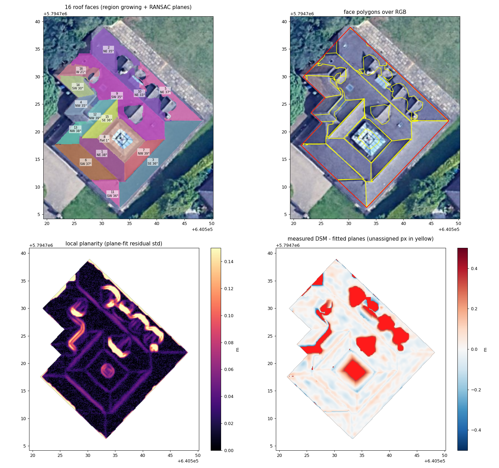
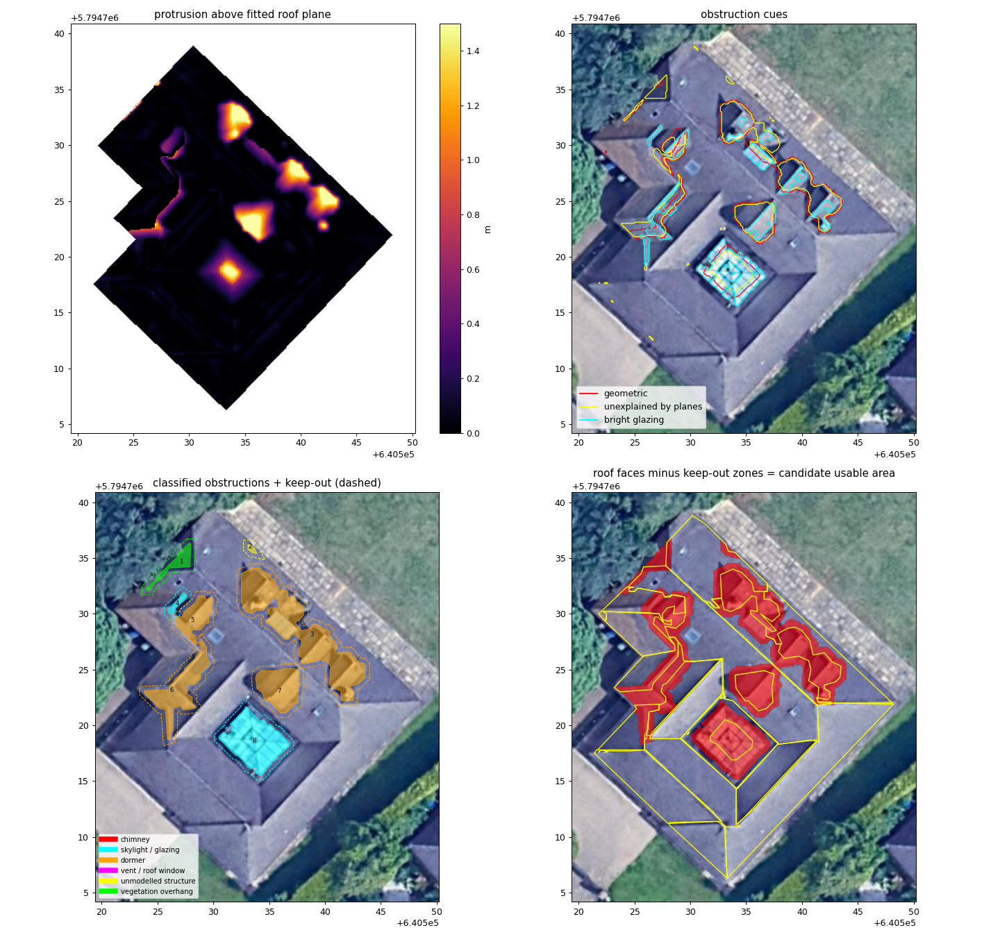
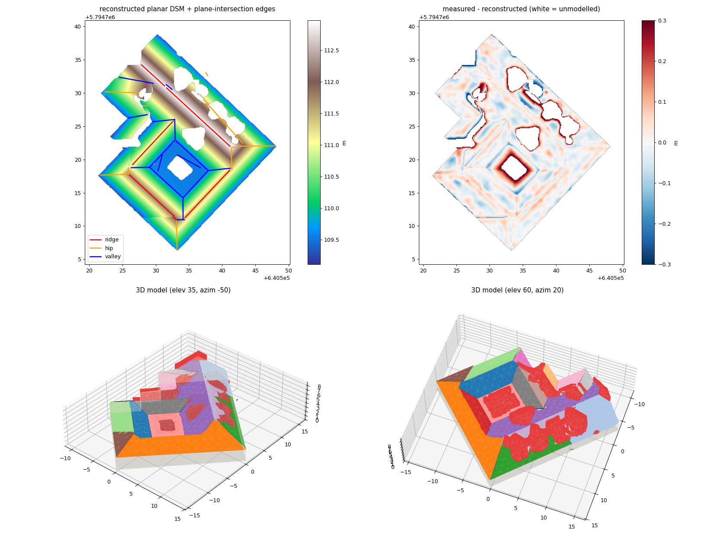
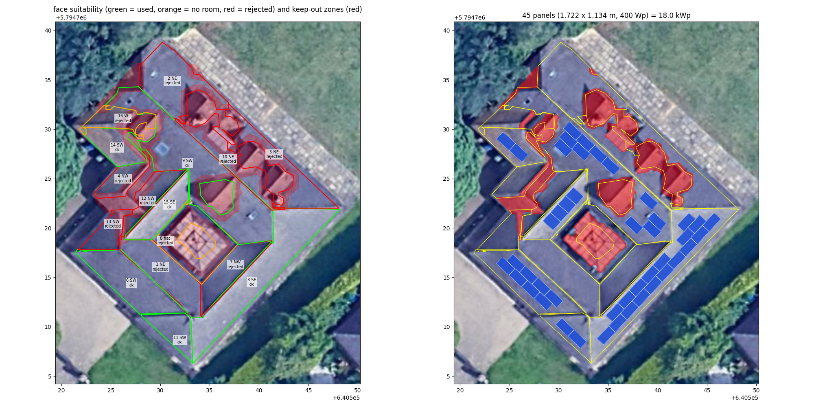
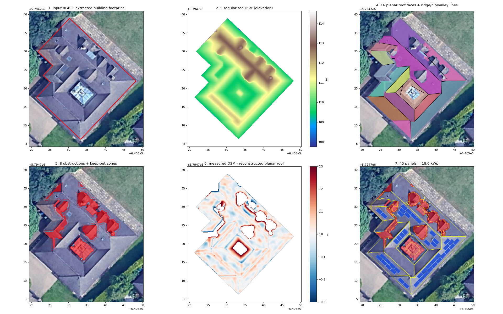

# Roof reconstruction & solar layout - results

Building footprint: **468.7 m²** (8 vertices, rectilinear), ground at 106.86 m.

DSM preprocessing: 0 nodata px filled, 0 spike px removed, residual noise std 0.019 m.

Roof model: **16 planar faces** covering 87.6% of the footprint (the rest is obstructions), RMSE planar model vs measured DSM **0.078 m**; 6 ridges, 10 hips, 15 valleys; mean height mismatch between adjacent planes along their shared border 0.094 m.

## Roof faces

| id | orientation | slope ° | aspect ° | area 2D m² | area 3D m² | RMSE m | panels |
|---|---|---|---|---|---|---|---|
| 1 | NE | 37.6 | 43 | 27.7 | 34.9 | 0.031 | 0 (rejected: aspect (north-facing)) |
| 2 | NE | 35.5 | 42 | 33.1 | 40.7 | 0.054 | 0 (rejected: aspect (north-facing)) |
| 3 | SE | 36.0 | 133 | 56.9 | 70.4 | 0.027 | 18 (ok) |
| 4 | NW | 34.6 | 309 | 11.4 | 13.9 | 0.089 | 0 (rejected: aspect (north-facing)) |
| 5 | NE | 37.5 | 44 | 26.4 | 33.2 | 0.078 | 0 (rejected: aspect (north-facing)) |
| 6 | SW | 36.9 | 223 | 31.9 | 39.8 | 0.038 | 8 (ok) |
| 7 | NW | 39.2 | 314 | 18.8 | 24.2 | 0.035 | 0 (rejected: aspect (north-facing)) |
| 8 | flat | 0.6 | -1 | 29.6 | 29.6 | 0.133 | 0 (rejected: not enough usable area) |
| 9 | SW | 35.1 | 223 | 71.6 | 87.5 | 0.057 | 11 (ok) |
| 10 | NE | 32.6 | 43 | 21.3 | 25.3 | 0.109 | 0 (rejected: aspect (north-facing)) |
| 11 | SW | 35.8 | 224 | 12.8 | 15.7 | 0.033 | 2 (ok) |
| 12 | NW | 39.1 | 314 | 14.2 | 18.2 | 0.071 | 0 (rejected: aspect (north-facing)) |
| 13 | NW | 38.0 | 315 | 11.1 | 14.0 | 0.066 | 0 (rejected: aspect (north-facing)) |
| 14 | SW | 29.9 | 222 | 14.6 | 16.9 | 0.058 | 2 (ok) |
| 15 | SE | 36.4 | 132 | 16.9 | 20.9 | 0.030 | 4 (ok) |
| 16 | W | 20.7 | 284 | 12.5 | 13.4 | 0.090 | 0 (rejected: not enough usable area) |

## Obstructions

| id | kind | area m² | height above roof m |
|---|---|---|---|
| 1 | vegetation overhang | 3.3 | 1.25 |
| 2 | unmodelled structure | 0.3 | 0.00 |
| 3 | dormer | 38.2 | 1.75 |
| 4 | skylight / glazing | 1.0 | 0.04 |
| 5 | dormer | 7.3 | 0.58 |
| 6 | dormer | 13.5 | 0.83 |
| 7 | dormer | 11.6 | 2.04 |
| 8 | skylight / glazing | 19.4 | 1.38 |

## Panel layout

* modules: 1.722 x 1.134 m, 400 Wp, edge setback 0.4 m, obstruction clearance 0.4 m
* **45 panels, 18.0 kWp**, 87.9 m² of modules on 164.1 m² usable roof surface
* mean orientation yield factor of the placed panels: 0.92 (1.0 = optimal tilt/azimuth)

### Geometric validation

* n_panels: 45
* overlapping_pairs: 0
* panels_closer_than_clearance_to_obstruction: 0
* panels_outside_face: 0
* setback_violations: 0
* max_3d_size_error_m: 1.2475809274548055e-09
* max_out_of_plane_m: 1.1137152175920936e-14

## Figures

